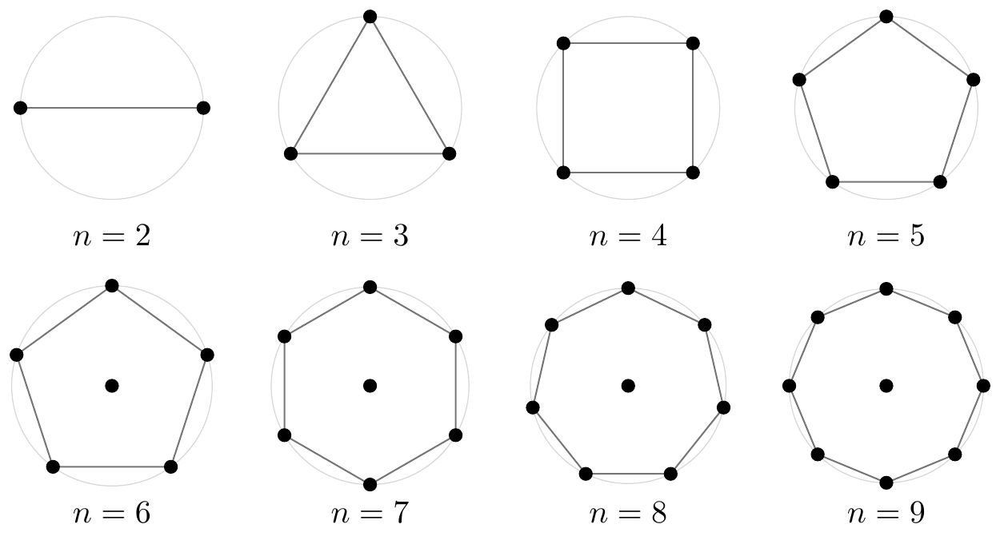

# Optimal Configurations for Mordell’s Problem

[English](README.md) · [中文](README.zh-CN.md)

**First public release: 2026-10-29 · [v0.1.0](https://github.com/Jxxxx-2001/mordell-discriminant/releases/tag/v0.1.0).**

**Content updated: 2026-11-02.**

## The problem

For complex numbers $`z_1,\ldots,z_n`$ satisfying

```math
\sum_{i=1}^{n}|z_i|^2=n,
```

determine the maximum $`M_n`$ of

```math
\Delta(z)=\prod_{1\le i\lt j\le n}|z_i-z_j|^2
```

and all maximizing configurations. The points range over the whole complex plane: the constraint fixes the total squared radius, not each individual radius.

Write

```math
C_n=(n-1)^{n-1}\left(\frac{n}{n-1}\right)^{n(n-1)/2}
```

for the value of a regular $`(n-1)`$-gon together with its center.

## Origins

- **1958:** Birch conjectured that $`M_n=n^n`$, attained by a regular $`n`$-gon on the unit circle.
- **1960:** Mordell proved the three-point case, with $`M_3=27`$ and equality precisely for a unit equilateral triangle.
- **The same year:** Chalk disproved the conjecture for every $`n\ge6`$: the origin and a regular $`(n-1)`$-gon of radius $`\sqrt{n/(n-1)}`$ give $`C_n>n^n`$. Determining the actual maximum and its maximizers remains a further problem.
- **1999:** Gueron and Shafrir reported numerical evidence for the centered polygon at six through nine points, gave ten-point coordinates improving on it, and proved its instability for every $n\ge11$. [Article, Theorem 1 and Figure 1](https://doi.org/10.1137/S0036139997315258)
- **2011:** Kailiang Lin proved $`M_4=256`$, with equality precisely for a unit square.
- **2026:** Preprints proved $`M_5=3125`$, with equality precisely for a unit regular pentagon. Jie Wang submitted a proof in September; Tiancheng Xu, Guowei Dou, and Wensheng Yu submitted a proof using Wang's algebraic results in October.

## Main results

Let $S_n$ consist of the origin and the vertices of a regular $(n-1)$-gon of radius $\sqrt{n/(n-1)}$, and let $C_n=\Delta(S_n)$.

| Number of points | Result | Maximizers or proof of exclusion |
|---|---|---|
| $2\le n\le5$ | $M_n=n^n$ | Equally spaced points on the unit circle, including an antipodal pair for two points. [Proofs and sources](proofs/n2-n5/README.md) |
| $6\le n\le9$ | $M_n=C_n$ | Only $S_n$, up to rotation and relabeling. Proofs for [six](proofs/n6/README.md), [seven](proofs/n7/README.md), [eight](proofs/n8/README.md) and [nine points](proofs/n9/README.md). |
| $n\ge10$ | $M_n>C_n$ | A direct comparison at ten points and an instability theorem for every $n\ge11$ exclude $S_n$. The sharp values in this range are undetermined here. [Proof](proofs/n10/README.md) |



**Figure 1. Optimal configurations for Mordell’s problem, $2\le n\le9$.** [Vector figure (PDF)](assets/mordell-2-9.pdf)

The six-point proof uses algebraic elimination and a recorded exact dimension computation. For seven points we use the complete [Faugère–Svartz classification](https://doi.org/10.1145/2442829.2442856) and compare twelve equilibrium classes. A [related public manuscript](https://github.com/harrykane8816627373-cell/mordell-research/tree/631e0feacf197f5c96f092bafbf17bc8cbd0ef32/earlier-results) also treats six and seven points. For eight and nine points a certified inequality for pairs gives a global bound after summation. The equality conditions recover the radii and the regular outer polygon.

## Quick verification

Use Python 3.12 or newer:

```sh
python verify.py
python verify.py --level check --case n10
```

The first command audits the distributed files and saved certificates. The second recomputes both ten-point integer comparisons using only the standard library. To check other computations:

```sh
python -m pip install -r requirements.txt
python verify.py --level check --case n7
```

Complete covers can be replayed when needed; see [verification](verification/README.md). The default command launches neither searches nor full covers.

## Relation to an Erdős problem on minimum diameter

Bateman and Erdős asked how small the diameter of $n$ planar points can be if every pair is at least one unit apart. Rescaling the shortest distance to one turns the diameter into the ratio of the largest to the smallest pairwise distance. They proved the seven-point minimum, and Bezdek and Fodor determined the eight-point minimum. [Bateman–Erdős (1951)](https://renyi.hu/~p_erdos/1951-03.pdf) · [Bezdek–Fodor (1999)](https://doi.org/10.1006/jcta.1998.2889)

For each $2\le n\le8$ the two problems have a common optimal shape. At eight points the full sets of optimizers differ. Nine is the first point count with no common optimizer. For every $n\ge10$ both problems exclude $S_n$; whether their actual optimizers coincide is a separate question. [Comparisons and integer witnesses](proofs/ratio/README.md) · [Friedman’s illustrated catalogue](https://erich-friedman.github.io/packing/maxmin/)

## Citation

Manuscript: Xiang Ji, Tiancheng Xu and Wensheng Yu, *Optimal Configurations for Mordell’s Problem*. For the software, cite the release or commit used. [Citation metadata](CITATION.cff)
