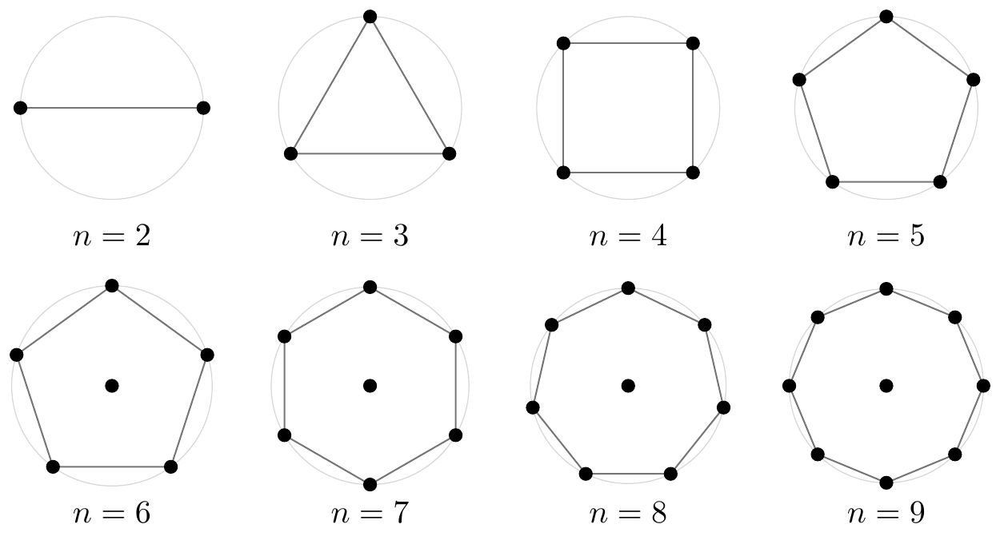

# Mordell 问题的最优构型

[English](README.md) · [中文](README.zh-CN.md)

**首次公开：2026-10-29 · [v0.1.0](https://github.com/Jxxxx-2001/mordell-discriminant/releases/tag/v0.1.0)。**

**内容更新：2026-11-02。**

## 问题

对满足

```math
\sum_{i=1}^{n}|z_i|^2=n
```

的复数 $`z_1,\ldots,z_n`$，求距离平方乘积

```math
\Delta(z)=\prod_{1\le i\lt j\le n}|z_i-z_j|^2
```

的最大值 $`M_n`$，以及取得最大值的全部构型。点可以位于整个复平面；约束的是总平方模，不是每个点的半径。

记中心加正 $`(n-1)`$ 边形的值为

```math
C_n=(n-1)^{n-1}\left(\frac{n}{n-1}\right)^{n(n-1)/2}.
```

## 问题由来

- **1958年**，Birch 猜想最大值为 $`n^n`$，由单位正 $`n`$ 边形取得。
- **1960年**，Mordell 证明 $`n=3`$ 时猜想成立，最大值为 $`27`$，等号对应单位正三角形。
- **同年**，Chalk 取原点加半径 $`\sqrt{n/(n-1)}`$ 的正 $`(n-1)`$ 边形，给出所有 $`n\ge6`$ 的反例：$`C_n>n^n`$。真正最大值与最大构型的确定由此成为进一步的问题。
- **1999 年**，Gueron 与 Shafrir 将六至九点的中心多边形列为数值优化得到的候选，给出十点的改进坐标，并证明对每个 $n\ge11$ 该构型失稳。[原文定理 1 与图 1](https://doi.org/10.1137/S0036139997315258)
- **2011年**，林开亮证明 $`n=4`$ 时最大值为 $`256`$，等号对应单位正方形。
- **2026年**，五点情形出现预印本证明，得到 $`M_5=3125`$，等号对应单位正五边形。Jie Wang 于9月提交证明；Tiancheng Xu、Guowei Dou、Wensheng Yu 于10月提交利用前者代数成果的证明。

## 主要结果

记 $S_n$ 为原点加上半径 $\sqrt{n/(n-1)}$ 的正 $(n-1)$ 边形顶点构成的点集，$C_n=\Delta(S_n)$。

| 点数 | 结论 | 最优构型或排除依据 |
|---|---|---|
| $2\le n\le5$ | $M_n=n^n$ | 当且仅当各点在单位圆上等角间隔排列时取到。两点时是一对对径点。[证明与文献](proofs/n2-n5/README.zh-CN.md) |
| $6\le n\le9$ | $M_n=C_n$ | 除整体旋转和重标号外，唯一最优构型是 $S_n$。分别见[六点](proofs/n6/README.zh-CN.md)、[七点](proofs/n7/README.zh-CN.md)、[八点](proofs/n8/README.zh-CN.md)、[九点](proofs/n9/README.zh-CN.md)证明。 |
| $n\ge10$ | $M_n>C_n$ | 十点由显式构型严格超过 $S_{10}$，十一点及以上由失稳定理排除 $S_n$。这一区间的锐值仍未由上述结果确定。[证明](proofs/n10/README.zh-CN.md) |

<a href="assets/mordell-2-9.png"></a>

**图 1　Mordell 问题的二至九点最优构型。** [矢量图（PDF）](assets/mordell-2-9.pdf)

六点证明使用代数消元及有理商空间的精确维数记录。七点依据 [Faugère–Svartz 的完整分类](https://doi.org/10.1145/2442829.2442856)，严格比较十二类平衡构型。另有[公开文稿](https://github.com/harrykane8816627373-cell/mordell-research/tree/631e0feacf197f5c96f092bafbf17bc8cbd0ef32/earlier-results)讨论六、七点的锐界。八、九点则通过认证点对不等式，对全部点对求和得到全局上界，并由取等条件确定半径和外圈形状。

## 简短验证

Python 3.12 或更新版本：

```sh
python verify.py
python verify.py --level check --case n10
```

第一条检查所收文件和已有证书的一致性，第二条仅使用标准库重新核验十点的两组整数比较。需要复核其余计算时：

```sh
python -m pip install -r requirements.txt
python verify.py --level check --case n7
```

完整覆盖按需运行，说明见 [验证入口](verification/README.md)。默认命令不会启动大规模搜索或完整覆盖。

## 与 Erdős 最小直径问题的关系

Bateman 与 Erdős 研究了如下问题：平面上 $n$ 个点的两两距离至少为 1，其直径最小可以是多少？把最短点距缩放为 1 后，直径恰等于原来的最长与最短点距之比。他们证明了七点的最小直径，八点结果由 Bezdek 与 Fodor 确定。[Bateman–Erdős（1951）](https://renyi.hu/~p_erdos/1951-03.pdf) · [Bezdek–Fodor（1999）](https://doi.org/10.1006/jcta.1998.2889)

按相似意义比较，二至八点各有共同最优形状。八点时两问题的全部最优解集已经不同，九点首次没有共同最优形状。对每个 $n\ge10$，两个问题均排除 $S_n$，至于两者真正的最优形状是否重合，还须另行研究。[几何比较与整数构型](proofs/ratio/README.zh-CN.md) · [Friedman 构型目录](https://erich-friedman.github.io/packing/maxmin/)

## 引用

论文手稿：Xiang Ji、Tiancheng Xu、Wensheng Yu，*Optimal Configurations for Mordell’s Problem*。引用软件时请注明所用的发布版本或提交。[引用信息](CITATION.cff)
